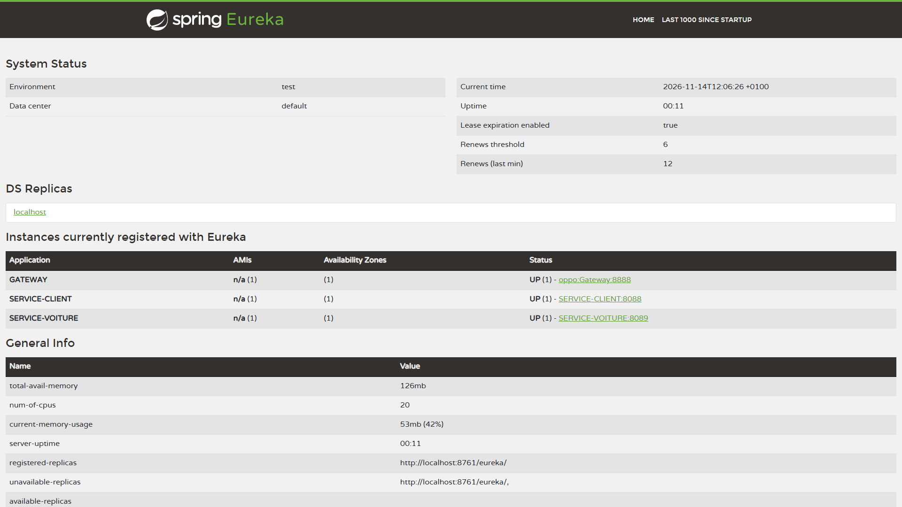
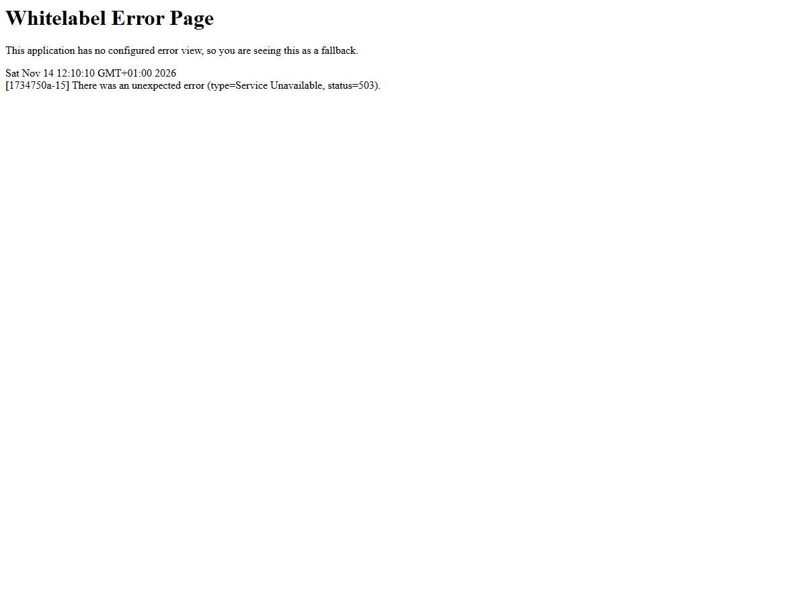
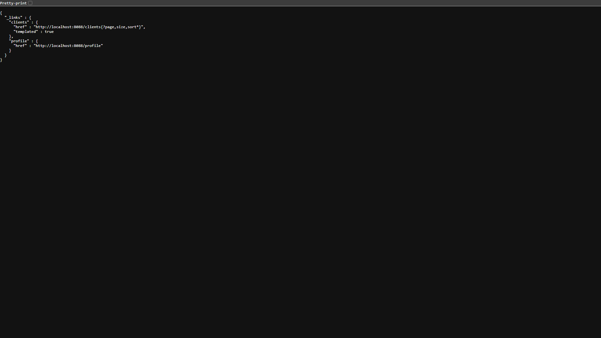
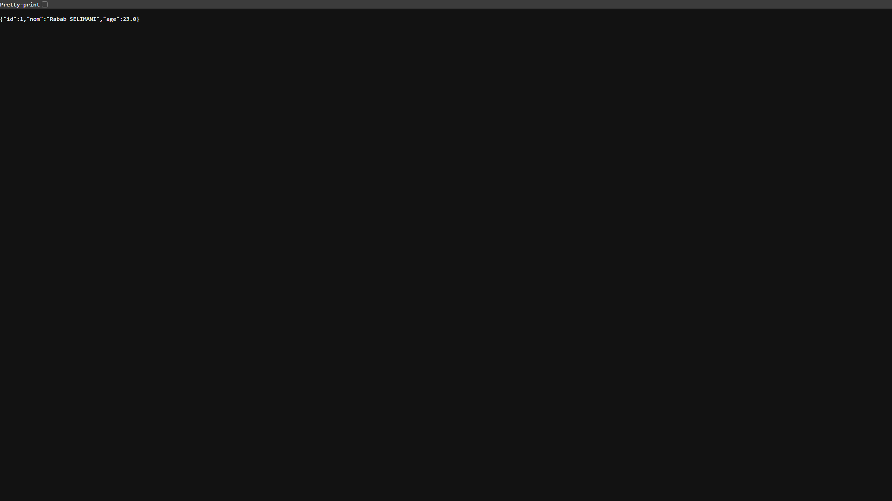
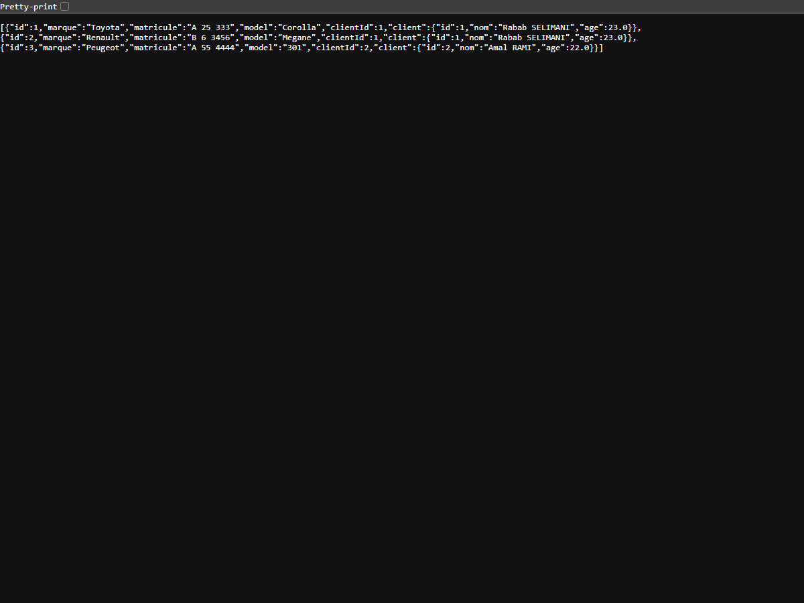

# TP — Architecture microservices avec Spring Boot et Spring Cloud

**Réalisé par : Ziyad Sabbar**

## 1. Présentation

L'objectif de ce TP est de mettre en place une architecture microservices avec Spring Boot et Spring Cloud. L'application gère des clients et leurs voitures à travers deux services indépendants. Eureka assure la découverte des services, la Gateway fournit un point d'entrée unique et OpenFeign permet la communication entre les deux microservices.

Le projet contient quatre applications :

| Application | Rôle | Port |
|---|---|---:|
| `TP19` | Serveur de découverte Eureka | `8761` |
| `Client` | Gestion des clients (`SERVICE-CLIENT`) | `8088` |
| `ServiceVoiture` | Gestion des voitures (`SERVICE-VOITURE`) | `8089` |
| `GateWay` | Point d'entrée et routage des requêtes | `8888` |

## 2. Technologies utilisées

- Java 21
- Spring Boot 4.1.2
- Spring Cloud 2025.1.4
- Netflix Eureka Server et Eureka Client
- Spring Cloud Gateway
- Spring Cloud OpenFeign
- Spring Data JPA
- Base de données H2 en mémoire
- Lombok
- Maven

## 3. Architecture

La Gateway ne dépend pas d'adresses fixes pour joindre les services. Elle utilise les noms enregistrés dans Eureka :

- `lb://SERVICE-CLIENT`
- `lb://SERVICE-VOITURE`

Le service Voiture utilise également le nom `SERVICE-CLIENT` dans son client Feign. Il peut ainsi récupérer les informations d'un client et les ajouter à la réponse d'une voiture sans connaître directement le port du service Client.

## 4. Organisation du projet

```text
TPP19/
├── TP19/                  # Serveur Eureka
├── Client/                # Microservice des clients
├── ServiceVoiture/        # Microservice des voitures
├── GateWay/               # API Gateway
├── docs/images/           # Captures de vérification
└── README.md
```

## 5. Fonctionnement des services

### 5.1 Serveur Eureka

Le module `TP19` est configuré avec `@EnableEurekaServer`. Il centralise les informations sur les instances disponibles et permet aux autres applications de se découvrir par leur nom.

Configuration principale :

```properties
server.port=8761
eureka.client.register-with-eureka=false
eureka.client.fetch-registry=false
```

### 5.2 Microservice Client

Le service Client expose une API REST permettant de consulter les clients enregistrés dans une base H2. Trois clients sont insérés automatiquement au démarrage avec un `CommandLineRunner`.

Ses deux formes d'URL pour la consultation individuelle sont conservées :

- `/client/{id}` pour l'accès demandé dans le TP ;
- `/clients/{id}` pour l'appel effectué par OpenFeign.

### 5.3 Microservice Voiture

Le service Voiture possède sa propre base H2 et stocke uniquement l'identifiant du client dans le champ `clientId`. L'objet `Client` est marqué `@Transient` car il est récupéré à distance et ne doit pas être enregistré dans la table `voiture`.

La communication avec le service Client est réalisée avec OpenFeign :

```java
@FeignClient(name = "SERVICE-CLIENT")
public interface ClientService {
    @GetMapping("/clients/{id}")
    Client clientById(@PathVariable("id") Long id);
}
```

L'initialisation reste tolérante si `SERVICE-CLIENT` n'est pas encore disponible : les voitures sont créées avec leur `clientId`, puis les informations des clients sont récupérées par Feign dès que le service est présent dans Eureka.

### 5.4 Gateway

La Gateway utilise des routes Java avec équilibrage de charge et découverte Eureka :

```java
.route("service-client", route -> route
    .path("/clients/**", "/client/**")
    .uri("lb://SERVICE-CLIENT"))
.route("service-voiture", route -> route
    .path("/voitures/**")
    .uri("lb://SERVICE-VOITURE"))
```

L'ancienne configuration statique est conservée dans `app.yml` à titre d'exemple. Comme ce fichier ne s'appelle plus `application.yml`, il n'est pas chargé automatiquement.

## 6. Endpoints disponibles

### Accès direct aux microservices

| Méthode | URL | Description |
|---|---|---|
| `GET` | `http://localhost:8088/clients` | Liste des clients |
| `GET` | `http://localhost:8088/client/1` | Client par identifiant |
| `GET` | `http://localhost:8088/clients/1` | Client par identifiant, utilisé par Feign |
| `GET` | `http://localhost:8089/voitures` | Liste des voitures avec leurs clients |
| `GET` | `http://localhost:8089/voitures/1` | Voiture par identifiant |
| `GET` | `http://localhost:8089/voitures/client/1` | Voitures appartenant à un client |
| `POST` | `http://localhost:8089/voitures/{clientId}` | Ajouter une voiture à un client |
| `PUT` | `http://localhost:8089/voitures/{id}` | Modifier une voiture |

### Accès à travers la Gateway

| Méthode | URL | Service ciblé |
|---|---|---|
| `GET` | `http://localhost:8888/clients` | `SERVICE-CLIENT` |
| `GET` | `http://localhost:8888/client/1` | `SERVICE-CLIENT` |
| `GET` | `http://localhost:8888/voitures` | `SERVICE-VOITURE` |
| `GET` | `http://localhost:8888/voitures/1` | `SERVICE-VOITURE` |
| `GET` | `http://localhost:8888/voitures/client/1` | `SERVICE-VOITURE` |

## 7. Lancement du projet

Chaque commande doit être exécutée dans un terminal différent, à partir de la racine `TPP19`.

### 1. Démarrer Eureka

```powershell
cd TP19
mvn spring-boot:run
```

### 2. Démarrer le service Client

```powershell
cd Client
mvn spring-boot:run
```

### 3. Démarrer le service Voiture

```powershell
cd ServiceVoiture
mvn spring-boot:run
```

### 4. Démarrer la Gateway

```powershell
cd GateWay
mvn spring-boot:run
```

L'ordre conseillé est donc : **Eureka → Client → ServiceVoiture → Gateway**.

## 8. Vérifications et résultats

### 8.1 Enregistrement dans Eureka

La console Eureka montre que les trois applications `GATEWAY`, `SERVICE-CLIENT` et `SERVICE-VOITURE` sont enregistrées avec le statut `UP`.



### 8.2 Liste des clients à travers la Gateway

L'URL `http://localhost:8888/clients` est routée par la Gateway vers `SERVICE-CLIENT`. Les trois clients initialisés sont retournés au format JSON.



### 8.3 Point d'entrée Spring Data REST

Le service Client expose également son point d'entrée Spring Data REST sur `http://localhost:8088`.



### 8.4 Consultation d'un client

L'appel `http://localhost:8088/clients/1` retourne le client demandé. Cette route est aussi celle utilisée par le client OpenFeign du service Voiture.



### 8.5 Liste des voitures à travers la Gateway

L'URL `http://localhost:8888/voitures` est routée vers `SERVICE-VOITURE`. Chaque voiture contient son `clientId` ainsi que les informations du client récupérées auprès de `SERVICE-CLIENT` avec OpenFeign.



### 8.6 Consultation d'une voiture à travers la Gateway

L'appel `http://localhost:8888/voitures/1` retourne la voiture demandée ainsi que les informations de son propriétaire obtenues depuis `SERVICE-CLIENT`.


## 9. Tests

Chaque module possède un test de chargement du contexte Spring. Le test de la Gateway vérifie aussi que les routes suivantes sont bien déclarées :

- `service-client=lb://SERVICE-CLIENT`
- `service-voiture=lb://SERVICE-VOITURE`

Les tests peuvent être lancés séparément avec :

```powershell
cd TP19
mvn test

cd ../Client
mvn test

cd ../ServiceVoiture
mvn test

cd ../GateWay
mvn test
```

Les builds Maven des quatre modules passent correctement.

## 10. Conclusion

Ce TP met en œuvre une architecture microservices complète : chaque domaine possède son service et sa base de données, Eureka assure la découverte, la Gateway centralise les accès et OpenFeign gère la communication entre services. Le routage par nom de service évite de coder les adresses des instances dans la Gateway et permet de faire évoluer l'architecture plus facilement.
